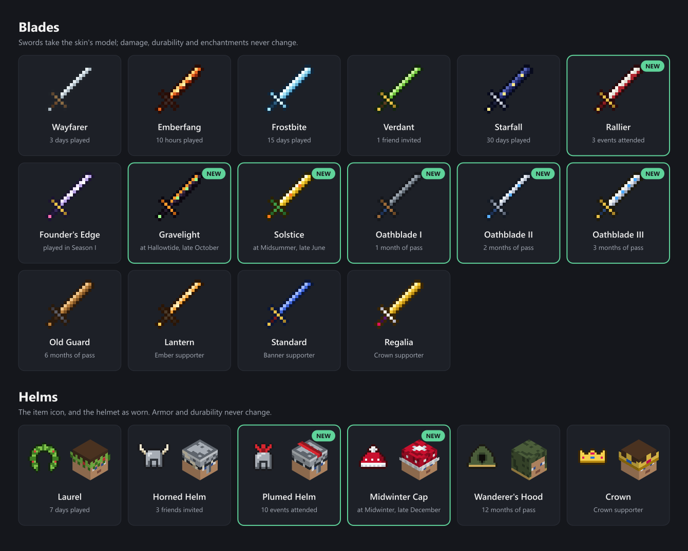

# Keeping players: the wardrobe, events and the numbers

Monkey SMP earns its keep from monthly passes, so the number that matters most is how many players
come back. This page covers what rewards staying, the commands the store and staff run, and how to
read retention from the server logs.

## The wardrobe

`/trigger wardrobe` opens a clickable menu of skins for swords and helmets, on three pages: skins earned in
game; pass and supporter skins; and this week's challenges with the challenge and founder skins (links at the
bottom switch; `/trigger challenges` opens the third). A skin changes only how the
item looks (its model, and on a helmet the worn look). Damage, armor, durability and enchantments
never change, and `tests/test_wardrobe.py` fails the build if one ever does. This follows Mojang's
rule that what players pay for must be cosmetic, and it keeps the server fair: the same pass price
for everyone, no advantage for sale.

Skins unlock by playing, by coming to events, by doing the weekly challenges, by staying, by bringing
friends, or by supporting:



| Skin | Kind | Unlocks at | Score |
| --- | --- | --- | --- |
| Wayfarer | blade | 3 days played | `rw.days 3` |
| Laurel | helm | 7 days played | `rw.days 7` |
| Emberfang | blade | 10 hours played | `rw.hours 10` |
| Frostbite | blade | 15 days played | `rw.days 15` |
| Starfall | blade | 30 days played | `rw.days 30` |
| Verdant | blade | 1 friend invited | `rw.invites 1` |
| Horned Helm | helm | 3 friends invited | `rw.invites 3` |
| Rallier | blade | 3 events attended | `rw.events 3` |
| Plumed Helm | helm | 10 events attended | `rw.events 10` |
| Gravelight | blade | came to Hallowtide (late October) | `rw.hallowtide 1` |
| Midwinter Cap | helm | came to Midwinter (late December) | `rw.midwinter 1` |
| Solstice | blade | came to Midsummer (late June) | `rw.midsummer 1` |
| Trailblazer | blade | 3 weekly challenges | `rw.challenges 3` |
| Vanguard Helm | helm | 9 weekly challenges | `rw.challenges 9` |
| Pinnacle | blade | 18 weekly challenges | `rw.challenges 18` |
| Oathblade I | blade | 1 month of pass | `rw.months 1` |
| Oathblade II | blade | 2 months of pass | `rw.months 2` |
| Oathblade III | blade | 3 months of pass | `rw.months 3` |
| Old Guard | blade | 6 months of pass | `rw.months 6` |
| Wanderer's Hood | helm | 12 months of pass | `rw.months 12` |
| Founder's Edge | blade | played in season 1 | `rw.founder 1` |
| Founder's Circlet | helm | played 10 minutes on Season I's launch weekend | `rw.launch 1` |
| Twinmoon | blade | played in Season II | `rw.s2 1` |
| Champion's Helm | helm | in the season champion's faction | `rw.champion 1` |
| Kindred Band | helm | a referral: a friend bought a pass with your code, or you with theirs | `rw.kin 1` |
| Lantern | blade | Ember supporter | `rw.tier 1` |
| Standard | blade | Banner supporter | `rw.tier 2` |
| Regalia | blade | Crown supporter | `rw.tier 3` |
| Crown | helm | Crown supporter | `rw.tier 3` |

Why these counters:

- **Days played, not streaks.** A day counts when a player is online at any point that UTC day. Streaks
  punish a missed weekend and push people to log in out of guilt; a count only goes up.
- **Tenure** (`rw.months`) rewards renewing the pass: the Oathblades, the Old Guard and the Wanderer's
  Hood can't be bought, only kept. The ladder starts at month 1 and steps at 2 and 3, so a new buyer gets
  something at each early renewal, when most passes lapse, instead of waiting six months. Steps add up:
  a 3-month pass unlocks the first three at once.
- **Events attended** (`rw.events`): Rallier at 3 and the Plumed Helm at 10. The events pack counts one
  per event when staff run `attend` (`docs/ADMIN.md`, "Attendance").
- **Holidays** (Gravelight, Midwinter Cap, Solstice) come only from being at that holiday's event
  (`docs/SEASONS.md`, "Holidays"). They are never sold: no store command sets these scores, and
  `tests/test_wardrobe.py` fails if one does. A skin missed this year comes back at next year's event.
- **Weekly challenges** (`rw.challenges`): Trailblazer at 3 (one full week), the Vanguard Helm at 9 and
  Pinnacle at 18 (six full weeks of a 12-week season, or more weeks with one or two done). The count
  carries to the next season, so a player who missed some weeks keeps climbing. See "Weekly challenges"
  below.
- **Founder.** Everyone who plays while `#season` is 1 gets Founder's Edge for good. End season 1 when
  the first wave is in (see below) so that the edge stays rare. If nobody does, the next season's carry
  sets `#season` to 2 in the new world.
- **Launch weekend.** Founder's Circlet is for being there at the start: 10 minutes online between the
  launch (Saturday 7 November 2026, 5 PM Pacific) and the end of Sunday 8 November, Pacific. It is never
  sold and never comes back. See "The launch weekend" below.
- **Later seasons.** Each season after the first has its own blade, as Founder's Edge is Season I's:
  Twinmoon for everyone who plays while `#season` is 2 (`SEASON_SKINS` in `tools/wardrobe.py`; the name is a
  placeholder until the owners pick one). It is hidden from the menu's locked list until Season II, so
  Season I's menu is unchanged, and it never comes back.
- **Champion.** The Champion's Helm is for everyone in the season champion's faction when the finale
  ended. Staff set `rw.champion` after the finale (`docs/SEASONS.md`, "Ending a season", step 4); it is
  never sold, and like every `rw.*` score it carries into the next season. Its locked line also waits for
  Season II.
- **Invites** line up with the invite ladder on the site (1, 3 and 5 friends).
- **Referrals.** The Kindred Band is for both players of a referral: a member's `/referral` code (Front Desk,
  the Discord bot) on a new buyer's Tebex purchase. It also counts one `rw.invites` for the code's owner, so
  referrals climb the invite ladder too. Never sold and no discount: the bot reads the code from the
  purchase's webhook and gives the skin, nothing else. It has no locked line in the menu, so it shows only to
  players who own it. Off until the owner turns it on (discord-server, `docs/TEBEX_WEBHOOK.md`, "Referrals").
- **Supporter tiers** get the flashiest skins, because they pay for the server.

`monkey-day.timer` starts a new day at midnight UTC (`docs/LIVE.md`, step 7), one per UTC date even when it
retries. Without it, nobody's day count moves.

When the store, staff or an event raises a player's months, events or a holiday score, they get an
"Unlocked ..." line in chat within a second, or at their next login if they were offline. Days played,
weekly challenges and the launch weekend announce themselves the same way.

All these scores live in the world, so a new season's world would start them at zero. The season-end
runbook carries them over, hours played included, along with the supporter, title and champion teams
below (`docs/SEASONS.md`, "Ending a season"). The season champion's title is a team like the titles
below, `champion_s1` and so on (`docs/SEASONS.md`, "The season champion").

### Weekly challenges

Three challenges a week, one of each kind: **solo** (mining, fishing, mobs, trading and the like),
**faction** (an event, a village raid, Nether and trial-chamber fights, easier with friends but done by each
player) and **explore** (loot chests and structures). Together they take about one to three hours of normal
play. Players see them with `/trigger challenges` (or the third wardrobe page): each one with the player's
progress, and a hover that says what counts. The first time a player is online in a new week, chat lists
the three. Finishing one plays a sound and says so in chat, and every finished challenge adds one to
`rw.challenges` for the skins above.

A new week starts every **Monday at 12 AM Pacific** (Sunday night, after the Saturday event). The
challenges rotate in a fixed order from a pool in `tools/challenges.py`, so anyone can see what is coming:
`python tools/challenges.py schedule` (`docs/ADMIN.md`, "Weekly challenges", also covers editing the pool).
The launch weekend is week 0 and runs the first of each kind; week 1 starts on Monday 9 November 2026.
`rules/launch` starts the week's progress from zero, and in Season I challenges done before the launch (test
play) don't count; later seasons keep the count they carried.

Only this week's play counts, and nothing can be farmed with an alt or a friend:

- **Blocks** count mined minus the same blocks placed, so placing and breaking again counts nothing, and
  blocks a friend places only move progress between the two of them.
- **Mobs** count only the listed mob types, never players, so the challenges never reward PvP.
- **Loot chests** count when a structure chest's loot is made, which happens once per chest, for whoever
  opens it first.
- **Structures** count once per kind, by setting foot in one.
- **Statistics** are only ones that take real play (fish caught, animals bred, trades, enchanting, raids
  won). Distance travelled and time online are never used: a water stream or a minecart loop would farm them.
- **Events** count any event begun this week (`docs/ADMIN.md`, "Attendance").

None of them needs griefing: structures and loot are out in the world, and nothing asks for another
faction's base.

Minecraft has no calendar, so `monkey-week.timer` tells the server the week every hour
(`deploy/monkey-week.sh`, `docs/LIVE.md`, step 7). The week is a score in the world, so the daily restart
and deploys keep it. Without the timer the week never turns over.

### The launch weekend

Founder's Circlet is the one skin tied to a date. `function monkey:rules/launch` (rule 23, the launch hour)
opens the window, and it closes by itself at the end of Sunday, Pacific: 31 hours of game time from the
Season I launch, kept to the wall clock by `monkey-week.timer` (game time stops while the server is empty). Every
second a player is online while it is open counts, so players who join hours after the launch hour get it
the same way; at 10 minutes in all it unlocks. Their seconds online (`rw.launchtime`) are not carried; the
skin (`rw.launch`) is. It works in Season I only. Staff fallbacks are in `docs/ADMIN.md`, "Weekly
challenges".

## Commands for the store and staff

Run these over RCON (`docs/LIVE.md`, "Day to day"). A Tebex package runs the same commands, with
`{username}` for the buyer's name.

| When | Command |
| --- | --- |
| A pass is bought | `whitelist add {username}` |
| The pass ends (cancelled, expired or refunded) | `whitelist remove {username}` |
| A supporter tier is bought (1 Ember, 2 Banner, 3 Crown) | `scoreboard players set {username} rw.tier 2` |
| The same purchase: chat name color | `team join tier_banner {username}` (or `tier_ember`, `tier_crown`) |
| It expires or is refunded | `scoreboard players set {username} rw.tier 0` and `team leave {username}` |
| A Banner or Crown player picks a title, or earns Herald (staff) | see "Titles" below |
| A Crown player names a landmark (staff, once a season) | see "Crown landmarks" below |
| A monthly pass renews | `scoreboard players add {username} rw.months 1` |
| A 3-month pass is bought | `scoreboard players add {username} rw.months 3` |
| A friend they invited buys a pass (staff) | `scoreboard players add NAME rw.invites 1` |
| A referral (Front Desk posts these in the mod channel, or sends them itself) | `scoreboard players set BUYER rw.kin 1`, `scoreboard players set NAME rw.kin 1`, `scoreboard players add NAME rw.invites 1` |
| That purchase is refunded or charged back (only if staff decide to) | `scoreboard players remove NAME rw.invites 1`, `scoreboard players reset BUYER rw.kin` (the referrer keeps theirs) |
| Season 1 ends (once) | `scoreboard players set #season rw.day 2` |

Skins already applied stay on the item when a tier expires; the menu just stops offering locked ones.

### Name colors and titles

The server has no chat-formatting mod, so supporter colors and titles use vanilla scoreboard teams: a
team's color and prefix show on the player's name in chat, the player list and the name tag. Nothing else on
the server uses teams (factions are Open Parties and Claims parties), and a player is on one team at a time.

Once, before the store opens:

```
team add tier_ember
team modify tier_ember color gold
team add tier_banner
team modify tier_banner color green
team add tier_crown
team modify tier_crown color light_purple
```

A title is a team of its own, with the tier's color and the title as a prefix (staff, by hand):

```
team add title_NAME
team modify title_NAME color green
team modify title_NAME prefix "[Herald] "
team join title_NAME NAME
```

When the tier expires, `team leave NAME` drops the color and the title; Herald earned with 10 invites is kept,
so put that player back with `team join title_NAME NAME`. Not yet checked in game: run these on a test server
and look at chat before the store opens.
That is deliberate: taking away a cosmetic someone paid for feels worse than the few cents it costs.

### Crown landmarks

Each season, every Crown supporter may name one landmark in the new world: a peak, a lake, an island, a
road or a ruin, but never a faction's base or anything inside someone's territory. Staff put the name on a
sign there and list the season's named landmarks in the Discord. The name has to pass the chat rules, and it
stays for the season even if the tier lapses. A name is all it is: no claim, no protection, no warp. Crown
used to include a vote on next season's mods and events; that went before the store opened, because a paid
say in gameplay isn't cosmetic. Every pass holder votes on the season's twist (docs/SEASONS.md).

## What else keeps people playing

- **The first hour.** Most players who leave do so on day one. Greet new names in chat and in
  Discord, give them a faction to join, and point them at `/trigger wardrobe`, where Wayfarer is
  3 days away.
- **A weekly rhythm and seasons.** One event a week in a fixed slot, a big moment every two to three
  weeks, and 12-week seasons with a finale and a fresh world: see `docs/SEASONS.md`.
- **Comebacks.** Reach out while a cancelled pass is still running, not after it has lapsed (below). A
  short, personal Discord DM about what's coming does more than a discount.

### When a pass is ending

A player who cancels a monthly pass keeps it until the month they paid for runs out. Until then Tebex
lists it as **Ending** (creator panel, Payments, Recurring Payments). That is the moment to talk to
them: they still have the server, and they decided recently enough to change their mind. A month after
it has lapsed, they have usually moved on.

- **Twice a week** (Monday and Thursday), a staff member filters Recurring Payments to Ending and sends
  each new name one Discord DM: what's coming this season, the next event, and one question, "Was there
  something that would have kept you?" No discount, no guilt, and no second message if they don't answer.
- **Write down the answer** next to their name in the staff channel, even when it is "no time".
- **Once a month**, read those answers with the reasons buyers gave Tebex when they cancelled, in the
  same sitting as the funnel numbers below. Three people saying the same thing is the next thing to fix.

Tebex can also send a webhook when a buyer cancels (`recurring-payment.cancellation.requested`). Front Desk
receives it and posts each new Ending pass (the player, the package, the end date and the reason) in the staff
channel, so nobody has to check (gr8monk3ys/discord-server, `docs/TEBEX_WEBHOOK.md`). It is off until the
owner exposes the endpoint over HTTPS, adds it in the Tebex panel and puts its secret in the bot's
`server/.env`; until then, check Recurring Payments by hand as above.

## Reading the numbers

```sh
python3 /srv/monkey/repo/tools/retention.py /srv/monkey/MonkeySMP-Server/server/logs
```

This reads the joins in the server logs. Nothing leaves the machine. It prints, for each week's new
players, the share who came back at least 1, 7 and 30 days later (D1, D7, D30), plus the number of
different players each week. A cell shows `-` until enough days have passed to judge it.

Worth checking monthly, next to the pass funnel below:

- **D7 under about 30%**: the first days aren't landing. Work on onboarding before adding content.
- **Different players each week falling** while D7 holds steady: you aren't getting new players. The
  invite ladder and the site matter more than features.
- **Pass churn** (passes not renewed, divided by passes active at the start of the month).

### The pass funnel: from purchase to renewal

```sh
python3 /srv/monkey/repo/tools/funnel.py ~/payments.csv /srv/monkey/MonkeySMP-Server/server/logs --log-tz America/Los_Angeles
```

Export the payments from Tebex (creator panel, Payments, Export as CSV) and copy the file to the VPS.
The tool matches each buyer to the server logs by name, and by UUID after a name change, and follows
them through five steps: the purchase, their first join, 30 minutes played, coming back a week after
that first join (D7), and the pass renewed. It prints:

- **Month-2 renewal**, the headline: of the monthly passes whose first month is over, the share that
  paid for a second. The budget below runs on this number. Passes whose month isn't over yet are counted
  as "not due yet", not as lost.
- The same for 3-month passes, once their three months are up.
- A row for each month's new buyers: how many joined, played 30 minutes, came back after a week, and
  renewed.
- **Bought a pass but never joined**: send each of them the install help (`docs/SHARING.md`) that day.

D7 is the diagnostic, renewal is the result. Read the steps in order and fix the first one that leaks:

- **Buyers who never join, or leave before 30 minutes**: the install or the first hour is the problem
  (the modpack download, the launch-hour rules, nobody saying hello), not the content.
- **30 minutes, but no D7**: the first week. See "The first hour" and the weekly rhythm above.
- **A good D7, but no renewal**: the month itself, its events and the Ending DMs' answers.

The CSV holds buyers' emails and IP addresses: keep it on the VPS or your own machine, never in the
repo (`.gitignore` skips `*.csv`; the only one committed is the made-up fixture in `tests/fixtures/`),
and delete it after the run. Tebex's dates are UTC and the live server logs Pacific time (`TZ` in
`docker/.env`), which is what `--log-tz` is for. The tool finds Tebex's columns by name and says
which it used; `--col username="Minecraft Username"` overrides a wrong guess. It warns about buyers who
bought before the oldest log, since it can't follow them.

## Churn and the budget

Tebex takes a 5% platform fee and card processing about 2.49% + $0.30 of each payment. After both, the $5
monthly pass brings in about $4.33 and the $14 three-month pass about $12.65, or $4.22 a month. The server
costs about $50 a month (the $45 VPS in docs/LIVE.md, plus off-site backups and the fallback tunnel), so it
breaks even at 12 paying players whichever pass they choose. The table below assumes monthly passes.

Three monthly passes cost $15, so the three-month pass is about 7% cheaper. Mojang's rule is that access
costs the same for everyone, which the official server list reads as payment options "equal in value, or
close to". At $12 (20% off) the three-month pass stretched that reading and earned less than monthly
passes: about $10.80, or $3.60 a month. Tebex can't change the price of a subscription already sold, so
the prices were settled before the first sale (docs/adr/0008-pass-prices-settled-before-the-first-sale.md).

A creator code (the site's /creators page) pays its creator 20% of a three-month pass, and Tebex takes 1% more on
payments made with a code, which leaves about $9.70 ($3.24 a month). Codes are for finding players, not
for paying the server.

| Monthly pass churn | Months a payer stays | Lifetime value | New payers a month to hold 30 |
| --- | --- | --- | --- |
| 25% | 4 | $17.32 | 7.5 |
| 15% | 6.7 | $28.87 | 4.5 |
| 10% | 10 | $43.30 | 3 |

Cutting churn from 25% to 10% is worth as much as more than doubling the new players you find each
month. That is why the wardrobe rewards days played and tenure, not purchases.
